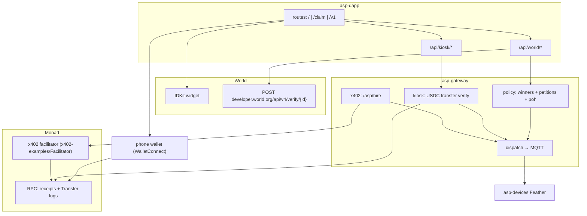
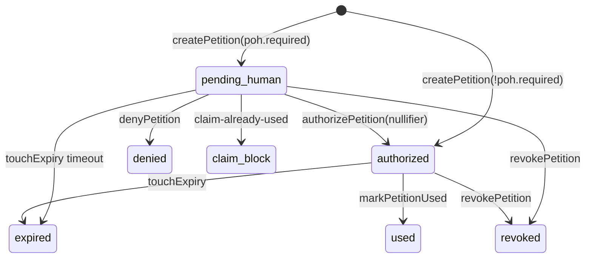

# AGENT.md — Asp integration contract

Technical reference for **automated buyers / orchestrators** that call Asp over HTTP + MQTT, and for auditors reviewing those paths. Product pitch for people: [`README.md`](./README.md). Booth walkthrough: [`SIMULATOR.md`](./SIMULATOR.md).

| Field | Value |
|---|---|
| Product | Asp / AntiScalper Protocol |
| Rails | World (Proof of Human), Monad (USDC settlement, chain `eip155:143`) |
| Trust model | Fail-closed. Never treat client `onSuccess` or a local `paid=true` as authority. |

---

## 0. Invariants

1. `client_idkit_onSuccess ≠ authorization`
2. `payment_received ≠ entitlement`
3. `authorized_petition ∧ settled_payment ∧ unused_claim → at_most_one MQTT dispense`
4. Same World `nullifier` cannot successfully claim the same `release_id` twice
5. Ticket `WIN-*` binds to one nullifier; claim must present matching nullifier
6. Claim World proof `signal` SHOULD equal `petition_id`
7. Lab pay intents NEVER dispatch motor (`lab-intent-no-dispense`)
8. In-memory stores (winners, petitions, intents, used tx hashes) RESET on gateway process restart
9. Physical dispense is MQTT single-shot; one Monad tx hash can pay at most one intent

---

## 1. System graph



---

## 2. Constants / identifiers

| Symbol | Value | Where |
|---|---|---|
| `ENROLL_ACTION` | `asp-enroll-metropolis-capsule-v1` | `asp-dapp/src/features/hire/gateway.ts` |
| `RELEASE_ID` | `metropolis-capsule-v1` | same |
| Ticket format | `WIN-` + 6 alnum uppercase | `winners.js` `makeTicket()` |
| Petition id prefix | `pet_` | `store.js` `makeId('pet')` |
| Demo ticket storage key | `asp.demoTicket.v1` | `aspDemoTicket.ts` (browser only; not auth) |
| MQTT passive action | `asp/passive/{deviceId}/action` | `dispatcher.js` |
| MQTT active intent | `asp/active/{deviceId}/intent` | `dispatcher.js` |
| MQTT receipt suffix | `/receipt` | `resolveReceipt` |
| Monad chain | `143` (`eip155:143`); testnet `10143` | `monad/chain.js` |
| USDC (Monad mainnet) | `0x754704Bc059F8C67012fEd69BC8A327a5aafb603` (6 decimals, EIP-3009) | `monad/chain.js` |
| Kiosk nonce tag | first 16 bytes of `keccak256("asp-kiosk:" + nonce)`, appended to transfer calldata | `monadPayment.js` |
| Env gateway URL | `EXPO_PUBLIC_GATEWAY_URL` | dapp |
| Env WalletConnect | `EXPO_PUBLIC_REOWN_PROJECT_ID`, `EXPO_PUBLIC_MONAD_CHAIN_ID` | dapp |
| Env facilitator | `FACILITATOR_URL` | gateway settings |
| Env World | `WORLD_APP_ID`, `WORLD_RP_ID`, `WORLD_STAGING_VERIFICATION_TOKEN`, `EXPO_PUBLIC_WORLD_ENVIRONMENT` | dapp+gateway |

---

## 3. State machines

### 3.1 Petition (`store.js`)

```
statuses ∈ {
  pending_human,   # PoH required, not yet authorized
  authorized,      # may create pay intent / hire
  used,            # dispense completed / marked used
  expired,         # past expires_at
  revoked,
  denied
}
```



Fields (record):

```json
{
  "petition_id": "pet_…",
  "requester": "kiosk|0x…|agent",
  "target_hardware_id": "Sub_…",
  "command": ["DISPENSE_ONCE"],
  "max_amount": "string",
  "release_id": "metropolis-capsule-v1|null",
  "status": "pending_human|authorized|…",
  "proof_of_human": { "required": true, "freshness_seconds": 300, "release_id": "…" },
  "release_action": "asp-release-{release_id}|null",
  "job_action": "asp-job-{petition_id}",
  "created_at": 0,
  "expires_at": 0,
  "authorized_at": null,
  "used_at": null,
  "nullifier": null,
  "subject_ref": null
}
```

### 3.2 Winner ticket (`winners.js`)

```json
{
  "ticket": "WIN-ABC123",
  "nullifier": "lowercase-hex-or-string",
  "release_id": "metropolis-capsule-v1",
  "session_id": null,
  "enrolled_at": 0,
  "claimed_at": null,
  "last_petition_id": null
}
```

Maps: `ticket → record`, `nullifier → ticket`, `session_id → ticket`.

### 3.3 Product UI phases (checkout)

Informal UI phases in `useCheckoutFlow.ts` / `useDemoV1Flow.ts`:
`idle → awaiting_human → authorized → awaiting_phone_pay (WalletConnect) → executing → done|error|denied`

---

## 4. World rail — contracts

### 4.1 Preferred verify topology

```
IDKit proof
  → asp-dapp verifies at World portal (fresh WORLD_STAGING_VERIFICATION_TOKEN + User-Agent)
  → asp-gateway authorize-preverified | winners/register (preverified:true)
```

Do NOT prefer gateway-side World verify for live demo (token staleness → 403).

### 4.2 Dapp World API

#### `POST /api/world/rp-signature`

| | |
|---|---|
| FILE | `asp-dapp/src/app/api/world/rp-signature+api.ts` |
| AUTH | server-only `WORLD_RP_SIGNING_KEY` |
| BODY | `{ action?: string, session?: boolean }` |
| RULE | uniqueness: pass `action`; session create/prove: `{ session:true }` omit action |
| OUT | signed request for IDKit |

#### `POST /api/world/enroll`

| | |
|---|---|
| FILE | `asp-dapp/src/app/api/world/enroll+api.ts` |
| BODY | `{ idkitResponse, action?, signal? }` |
| STEPS | portal verify → extract nullifier → `POST {GATEWAY}/asp/winners/register` with `preverified:true` |
| OUT | `{ ok, ticket, winner, … }` |
| FAIL | `missing-idkit-response`, `world-ids-missing`, `world-verify-failed`, `missing-nullifier`, gateway 502 |

#### `POST /api/world/poh-verify`

| | |
|---|---|
| FILE | `asp-dapp/src/app/api/world/poh-verify+api.ts` |
| BODY | `{ petition_id, idkitResponse, action?, signal?, ticket? }` |
| DEFAULT_ACTION | `asp-enroll-metropolis-capsule-v1` |
| STEPS | portal verify → `POST {GATEWAY}/asp/proof-of-human/authorize-preverified` |
| OUT | `{ ok, via:'dapp-verify+preverified-authorize', …gateway }` |
| FAIL | `missing-petition_id`, `world-verify-failed`, `missing-nullifier`, `authorize-failed`, `claim_already_used` |

#### `POST /api/world/enroll-session` / session bind

Secondary World ID 4.0 session path. Production signup prefers legacy uniqueness enroll (`enroll`). Files: `enroll-session+api.ts`, `WorldSessionModal.tsx`.

#### `POST /api/world/verify-proof`

Lab-only isolated verify. File: `verify-proof+api.ts`.

### 4.3 Gateway policy HTTP

Base: gateway `EXPO_PUBLIC_GATEWAY_URL` / `ASP_GW_HTTP_PORT`.

#### `POST /asp/petition`

```json
// request
{ "requester": "kiosk", "target_hardware_id": "Sub_…", "command": ["DISPENSE_ONCE"] }
// response (poh required)
{
  "ok": true,
  "petition": { "petition_id": "pet_…", "status": "pending_human", … },
  "next": {
    "message": "…",
    "verify_url": "/asp/proof-of-human/verify"
  }
}
```

FILE: `asp-gateway/src/services/policy/routes.js` → `createPetition` in `store.js`.

#### `GET /asp/petition/:id`

Return petition record or 404.

#### `POST /asp/proof-of-human/authorize-preverified`

```json
{
  "petition_id": "pet_…",
  "ticket": "WIN-…",
  "nullifier": "…",
  "session_id": "…",
  "signal": "pet_…",
  "preverified": true
}
```

Checks: petition exists, not expired, ticket/nullifier via `assertWinnerCanClaim`, signal match when provided, `authorizePetition`, claim-already-used.

#### `POST /asp/proof-of-human/verify`

Gateway calls `verifyWorldProof` then authorize. Prefer dapp `poh-verify` in production demo.

#### `POST /asp/winners/register`

```json
{
  "nullifier": "…",
  "release_id": "metropolis-capsule-v1",
  "preverified": true
}
```

→ `enrollWinner`.

#### `POST /asp/winners/enroll` | `enroll-session` | `bind-session`

Alternate enroll paths. See `routes.js` + `winners.js`.

#### `GET /asp/winners/:ticket` | `GET /asp/winners`

Lookup / list.

#### `POST /asp/proof-of-human/revoke` | `deny`

Terminal negative states.

#### `POST /asp/demo/reset-claims`

Clears claim registers for repeatable booth demo.

### 4.4 `verifyWorldProof` semantics

FILE: `asp-gateway/src/services/policy/pohVerify.js`

INPUT: IDKit response object + `{ expectedEnvironment, action, signal }`  
PROCESS:

1. Build verify id list: `rp_*` then `app_*`
2. Detect session proof vs uniqueness
3. Forward JSON to `https://developer.world.org/api/v4/verify/{id}`
4. Attach `x-staging-verification-token` when set
5. Require HTTP ok AND success flag
6. Extract nullifier / session_id
7. Optional env mismatch → `environment-mismatch`

OUTPUT:

```json
{ "verified": true|false, "nullifier": "…"|null, "session_id": "…"|null, "raw": {}, "error": "…" }
```

### 4.5 World error catalog

| code | meaning | agent action |
|---|---|---|
| `missing-idkit-response` | no proof | abort |
| `world-ids-missing` | env misconfig | abort / alert operator |
| `world-verify-failed` | portal reject | abort; refresh staging token if 401/403 |
| `missing-nullifier` | session-only without uniqueness | use uniqueness enroll path |
| `unknown-ticket` | not enrolled | send human to `/` Get |
| `already-claimed` | ticket redeemed | stop; motor must idle |
| `nullifier-mismatch` | different human | stop |
| `signal-mismatch` | wrong petition binding | redo PoH with signal=petition_id |
| `claim-already-used` | release nullifier spent | stop; product success for anti-scalp |
| `pending-human` | hire/pay too early | complete PoH first |
| `expired` | petition freshness elapsed | new petition |
| `environment-mismatch` | sandbox vs prod proof | align env |

---

## 5. Monad rail — contracts

Two parallel payment channels. Do not conflate. The kiosk channel is **not** x402.

| Channel | Who | Settle proof | Dispense entry |
|---|---|---|---|
| **A WalletConnect USDC transfer** | human phone at booth | mined USDC `Transfer` carrying the intent's nonce tag | `POST /asp/kiosk/dispense` |
| **B x402 hire** | agent/chat | x402 facilitator settles EIP-3009 `transferWithAuthorization` | `POST /asp/hire` after 402 dance |

Both require `assertHireAllowed` before motor.

### 5.1 Channel A — WalletConnect pay

#### Build pay request

FILE: `asp-gateway/src/services/kiosk/monadPayment.js`  
FN: `buildPaymentRequest({ receiver, amount, token, nonce })`  
OUT (as returned in `payment` by the intent routes):

```json
{
  "chainId": 143,
  "to": "0x754704Bc…USDC",
  "data": "0xa9059cbb…<receiver><amount><16-byte nonce tag>",
  "value": "0",
  "amount": "2000",
  "token": "0x754704Bc…USDC",
  "receiver": "0x…gateway"
}
```

The dapp hands `{ chainId, to, data }` to the connected wallet (`useWalletPay` → wagmi `sendTransaction`). USDC ignores the trailing tag; the gateway reads it back from the tx input.

#### Verify settlement

FN: `verifyUsdcPayment({ txHash, nonce, amount, token, receiver, notBeforeMs })`  
PASS only if: receipt `success` · `tx.to == USDC` · input ends with nonce tag · `Transfer(to=receiver, value=amount)` log from USDC · block not older than the intent.  
OUT: `{ ok:true, txHash, payer, amount, receiver, blockNumber, explorerUrl }` OR `{ ok:false, error, detail }`  
Errors: `invalid-tx-hash`, `payment-not-found`, `payment-reverted`, `payment-wrong-token`, `payment-nonce-mismatch`, `payment-amount-mismatch`, `payment-too-old`. Throws only on RPC failure (route maps to 502).

Replay guard: `intentStore.consumeTx(txHash, nonce)` — a tx hash that already paid another intent → `payment-tx-replayed` (409).

#### Gateway kiosk routes

FILE: `asp-gateway/src/services/kiosk/routes.js`

| Method | Path | Precondition | Behavior |
|---|---|---|---|
| POST | `/asp/kiosk/intent` | petition `authorized`, unused, unexpired | create intent + pay request |
| POST | `/asp/kiosk/lab/intent` | none | pay-only lab; no motor |
| POST | `/asp/kiosk/intent/:nonce/tx` | intent exists, body `{ txHash }` | verify → `paid` (200) or keep hash and wait (202) |
| GET | `/asp/kiosk/intent/:nonce` | intent exists | poll; re-checks a pending tx hash |
| POST | `/asp/kiosk/dispense` | body `{ nonce }`, intent paid | re-verify → assertHireAllowed → burn entitlement → MQTT (idempotent once dispensed) |
| POST | `/asp/kiosk/reset` | demo | clear intents |

`POST /asp/kiosk/intent` body:

```json
{ "petition_id": "pet_…" }
```

Errors: `missing-petition_id`, `petition-not-found`, `pending-human`, `petition-already-used`, `expired`, `invalid-skill-config`, `pay-intent-failed` (e.g. no gateway receiver configured).

`POST /asp/kiosk/dispense` errors: `missing-nonce`, `intent-not-found`, `lab-intent-no-dispense` (400), unpaid (402), RPC failure (502), gate errors, `esp32-no-receipt` (504, `claimed:true`).

#### Dapp kiosk proxies

| Path | File | Proxies to |
|---|---|---|
| `POST /api/kiosk/checkout-intent` | `checkout-intent+api.ts` | `/asp/kiosk/intent` |
| `POST /api/kiosk/submit-tx` | `submit-tx+api.ts` | `/asp/kiosk/intent/:nonce/tx` |
| `GET /api/kiosk/status?nonce=` | `status+api.ts` | `/asp/kiosk/intent/:nonce` |
| `POST /api/kiosk/complete` | `complete+api.ts` | `/asp/kiosk/dispense` |
| `POST /api/kiosk/lab-intent` | `lab-intent+api.ts` | `/asp/kiosk/lab/intent` |

Client helpers: `asp-dapp/src/features/kiosk/kioskPay.ts`  
Wallet: `asp-dapp/src/features/wallet/` (`appKit.ts`, `WalletProviders.tsx`, `useWalletPay.ts`)  
Pay UI: `WalletPayPanel.tsx`  
Poll loop: `useCheckoutFlow.ts`, `useDemoV1Flow.ts`

### 5.2 Channel B — x402 hire

FILE: `asp-gateway/src/services/x402/routes.js`

```
POST /asp/hire
  1. parse petition/skill
  2. assertHireAllowed({ skill, body: petition })  // BEFORE payment
  3. x402ResourceServer + HTTPFacilitatorClient(FACILITATOR_URL)
  4. exact EVM scheme on eip155:143, USDC EIP-3009, paymentFlow 'upfront'
     (facilitator settles BEFORE the handler, so the motor never runs unpaid)
  5. dispatch MQTT → markPetitionUsed → response carries settle tx hash
```

Client side (dapp chat, `useX402Fetch.ts`): first request → 402 → `x402HTTPClient.getPaymentRequiredResponse` → `createPaymentPayload` (wallet signs EIP-712 `TransferWithAuthorization`) → retry with `encodePaymentSignatureHeader`. Script example: `x402-examples/Buyer/asp-hire-smoke.mjs`.

Related discovery:

- `GET /asp/agent-guide.json`
- `GET /asp/skills`
- HTML agent docs under x402 router (`/agentic`, etc.)

Facilitator: `x402-examples/Facilitator/index.mjs` (`GET /health`, `/supported`, `POST /verify`, `/settle`). Holds a MON-funded key that pays gas for `transferWithAuthorization`; it never holds buyer funds.

SDK: `@x402/core`, `@x402/evm`, `@x402/express` (v2).

### 5.3 `assertHireAllowed` gate

FILE: `asp-gateway/src/services/policy/store.js`

Checks (non-exhaustive): petition exists; status `authorized`; not expired; requester match (unless skipped); PoH/nullifier/claim constraints; amount/skill alignment.

Return shape on fail: `{ ok:false, error, status, detail, claim_already_used? }`.

---

## 6. Dispatch / hardware

FILE: `asp-gateway/src/services/dispatch/dispatcher.js`

```
makeDispatch(mqttBroker, log)(petition, skill)
  if skill.execution_model === 'AGENTIC':
    publish asp/active/{target}/intent
    await receipt (timeout 120s)
  else:
    publish asp/passive/{target}/action  # command array / DISPENSE_ONCE
    await receipt (timeout ~15s)
```

`resolveReceipt`: match `tx_id` in-flight; fallback only if topic ends with `/receipt`.

DEVICE: `asp-devices` Feather firmware — subscribe action, spin once, publish receipt.  
Wiring/README: `asp-devices/README.md`.

---

## 7. Canonical sequences

### 7.1 Human Get ticket

```
1 UI / → WorldVerifyModal
2 POST /api/world/rp-signature { action: ENROLL_ACTION }
3 IDKit uniqueness proof
4 POST /api/world/enroll { idkitResponse, action }
5 dapp → World portal verify
6 dapp → POST /asp/winners/register { nullifier, release_id, preverified:true }
7 return ticket WIN-*
8 optional localStorage asp.demoTicket.v1
```

### 7.2 Human Claim + pay + motor

```
1 UI /claim enter ticket → GET /asp/winners/:ticket (must exist, !claimed_at)
2 POST /asp/petition { requester:'kiosk', target_hardware_id, command:['DISPENSE_ONCE'] }
3 status pending_human
4 WorldVerifyModal action=ENROLL_ACTION signal=petition_id ticket=WIN-*
5 POST /api/world/poh-verify { petition_id, idkitResponse, action, signal, ticket }
6 gateway authorize-preverified → status authorized
7 POST /api/kiosk/checkout-intent { petition_id } → nonce + payment {to, data}
8 WalletConnect QR → phone wallet sends USDC transfer → txHash
9 POST /api/kiosk/submit-tx { nonce, txHash }; loop GET /api/kiosk/status?nonce= until paid
10 POST /api/kiosk/complete { nonce } → gateway /asp/kiosk/dispense
11 gateway verifyUsdcPayment + assertHireAllowed + MQTT
12 mark petition used + markWinnerClaimed
13 UI success; second attempt → claim-already-used | already-claimed
```

### 7.3 Backup /v1 (no ticket)

```
Same as claim but skip ticket enroll gate; uniqueness PoH per demo flow;
deny on claim-already-used for release nullifier.
Files: useDemoV1Flow.ts, DemoV1Page.tsx
```

### 7.4 Agent hire

```
1 POST /asp/petition
2 Instruct human PoH (or Agents plugin flow) → authorize
3 POST /asp/hire with x402 payment headers / client retry after 402
4 facilitator settles the USDC authorization on Monad (pays gas)
5 dispatch + mark used
```

---

## 8. File index

### World / policy

| Path | Exports / role |
|---|---|
| `asp-gateway/src/services/policy/pohVerify.js` | `verifyWorldProof` |
| `asp-gateway/src/services/policy/winners.js` | `enrollWinner`, `assertWinnerCanClaim`, `markWinnerClaimed`, … |
| `asp-gateway/src/services/policy/store.js` | petitions + `assertHireAllowed` |
| `asp-gateway/src/services/policy/routes.js` | HTTP policy router |
| `asp-dapp/src/features/world/WorldVerifyModal.tsx` | IDKit UI |
| `asp-dapp/src/features/world/WorldSessionModal.tsx` | session UI |
| `asp-dapp/src/features/hire/gateway.ts` | typed client to gateway + dapp proxies |
| `asp-dapp/src/app/api/world/*` | enroll, poh-verify, rp-signature, … |

### Monad / kiosk / x402

| Path | Exports / role |
|---|---|
| `asp-gateway/src/services/monad/chain.js` | chain id, RPC fallbacks, USDC address, `publicClient` |
| `asp-gateway/src/services/monad/wallet.js` | gateway receiver address (no private key) |
| `asp-gateway/src/services/kiosk/monadPayment.js` | `buildPaymentRequest`, `verifyUsdcPayment`, `nonceTag` |
| `asp-gateway/src/services/kiosk/routes.js` | kiosk HTTP |
| `asp-gateway/src/services/kiosk/intentStore.js` | intent CRUD + `consumeTx` replay guard |
| `asp-gateway/src/services/x402/routes.js` | `/asp/hire`, agent-guide |
| `asp-dapp/src/features/kiosk/kioskPay.ts` | client kiosk pay helpers |
| `asp-dapp/src/features/wallet/*` | Reown AppKit, wagmi, `useWalletPay`, `useX402Fetch` |
| `asp-dapp/src/app/api/kiosk/*` | checkout-intent, submit-tx, status, complete, lab-intent |
| `x402-examples/Facilitator/` | Monad x402 facilitator |

### Dispatch / device

| Path | Role |
|---|---|
| `asp-gateway/src/services/dispatch/dispatcher.js` | MQTT publish + receipt wait |
| `asp-devices/` | firmware |

### UI orchestration

| Path | Role |
|---|---|
| `asp-dapp/src/features/control/SignupPage.tsx` | Get ticket |
| `asp-dapp/src/features/control/CheckoutPage.tsx` | Claim |
| `asp-dapp/src/features/control/useCheckoutFlow.ts` | claim state machine |
| `asp-dapp/src/features/control/DemoV1Page.tsx` | backup |
| `asp-dapp/src/features/control/useDemoV1Flow.ts` | backup state machine |
| `asp-dapp/src/features/control/WalletPayPanel.tsx` | phone wallet pay |
| `asp-dapp/src/app/index.tsx` | `/` → SignupPage |
| `asp-dapp/src/app/claim.tsx` | `/claim` → CheckoutPage |
| `asp-dapp/src/app/v1.tsx` | `/v1` → DemoV1Page |

---

## 9. Env checklist (operator)

Gateway `.env.example` keys (no secrets in git):

- `GATEWAY_ADDRESS` (receiver only — the gateway never signs)
- `MONAD_CHAIN_ID`, `MONAD_RPC_URL`, `USDC_ADDRESS`
- `MQTT_BROKER_URL`, `MQTT_BROKER_JWT`
- `FACILITATOR_URL`
- `WORLD_APP_ID`, `WORLD_RP_ID`, `WORLD_ENVIRONMENT`, `WORLD_STAGING_VERIFICATION_TOKEN`
- `ASP_GW_HOST`, `ASP_GW_HTTP_PORT`

Dapp:

- `EXPO_PUBLIC_GATEWAY_URL`
- `EXPO_PUBLIC_REOWN_PROJECT_ID`, `EXPO_PUBLIC_MONAD_CHAIN_ID`
- `EXPO_PUBLIC_WORLD_*`
- `WORLD_RP_SIGNING_KEY` (server only)
- `WORLD_STAGING_VERIFICATION_TOKEN`

---

## 10. Integration mistakes that break the product

1. Treating the IDKit client callback as sufficient authorization
2. Setting `paid=true` without a verified Monad USDC transfer / x402 settle proof
3. Calling `/asp/hire` or kiosk dispense while the petition is `pending_human`
4. Accepting any USDC transfer to the receiver without checking the nonce tag (replays another buyer's payment)
5. Retrying dispense after `claim-already-used` and expecting success
6. Using the lab intent path when a physical motor dispense is required
7. Logging or committing private keys, JWTs, or staging tokens

---

## 11. Minimal logical self-test

```
T1 enroll → ticket T
T2 petition → pending_human
T3 poh-verify wrong nullifier → fail
T4 poh-verify correct → authorized
T5 checkout-intent → nonce N
T6 status before pay → payment-not-found
T7 pay + submit-tx → status paid with tx hash
T7b submit same tx hash to a new intent → payment-tx-replayed
T8 complete → MQTT receipt ok
T9 complete/claim again → claim-already-used | already-claimed
T10 hire without authorize → pending-human
```

---

## 12. Related docs

- Product pitch / diagrams: `README.md`
- Booth walkthrough: `SIMULATOR.md`
- This file: HTTP/MQTT integration contract for automated clients and auditors
