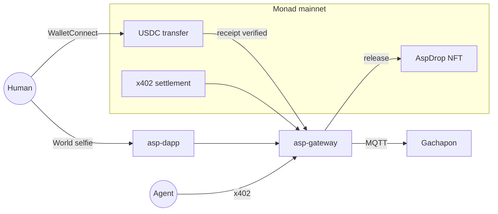
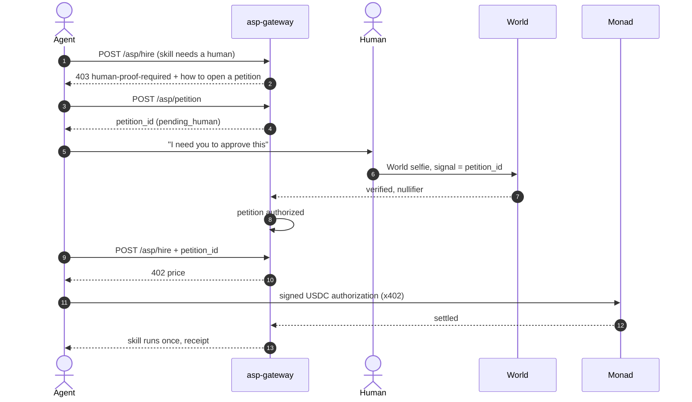

# Asp — AntiScalper Protocol

<div align="center">
  

**One human. One item. Settled on Monad.**  
A drop machine where every claim is a USDC payment on Monad that only a real person can make.

[Live demo](https://altaga-asp.expo.app) · [AspDrop on MonadVision](https://monadvision.com/address/0x942c1a378b961fb7a95b83ecaf55fecee42c6187) · [NFT drop](https://altaga-asp.expo.app/test/claim) · [Technical walkthrough](./TECHNICAL.md)

</div>

---

## Metropolis submission

| | |
|---|---|
| Chain | **Monad mainnet** (`eip155:143`), Circle USDC |
| Track | **03 · Social, Attention & Culture**: ticketing and access that follow a *person*, not an email or a wallet |
| On Monad | Kiosk payments verified on-chain · [`AspDrop`](https://monadvision.com/address/0x942c1a378b961fb7a95b83ecaf55fecee42c6187) ERC-721 with on-chain art · x402 agent payments with our own Monad facilitator |
| Identity | World ID (Proof of Human), so only real people reach the Monad payment |
| Hardware | XIAO ESP32-C5 gachapon that turns only after Monad confirms the payment |
| Live | [altaga-asp.expo.app](https://altaga-asp.expo.app) |

Built inside the [Metropolis](https://monad.xyz/developers/hackathons/metropolis) window: the repo starts on 30 Sep 2026.

---

## Built on Monad

Monad is the source of truth in Asp. A machine doesn't move, and an NFT doesn't mint, until the chain says the money arrived.

### 1 · Every claim is a USDC payment on Monad

The person pays from their own phone wallet over WalletConnect. The transfer carries a tag unique to that claim, and the gateway reads the receipt straight from Monad before doing anything:

- the tx called Circle's USDC contract and succeeded
- the calldata ends with **this claim's** nonce tag (`keccak256("asp-kiosk:" + nonce)`)
- a `Transfer` log moves **exactly** the price to the gateway's receiver
- the block is newer than the claim, and the tx hash was never used before

No `paid=true` checkbox and no payment processor. If Monad doesn't show it, nothing happens.

### 2 · The drop lives on Monad

[`AspDrop`](https://monadvision.com/address/0x942c1a378b961fb7a95b83ecaf55fecee42c6187) is a 20-edition ERC-721 on Monad mainnet. The capsule art is generated **by the contract** (`tokenURI` → base64 JSON → base64 SVG), so there's no IPFS and no server to go down. `release(payer, claimId)` mints at most one edition per paid claim, so a retry returns the same token instead of a second one.

### 3 · Agents pay on Monad too

Machines and services on Asp can be hired per call over **x402**, settled in USDC on Monad through our own facilitator (EIP-3009 `transferWithAuthorization`, the facilitator pays the gas). [More below](#agents-hire-over-x402-call-the-human-when-it-matters).

### Why Monad

| | Why it matters at a vending machine |
|---|---|
| **Sub-second blocks** | Someone is standing in front of the machine. The payment confirms before they look up from the phone. |
| **Cheap gas** | Minting a collectible per claim, and verifying every claim on-chain, only makes sense when it costs fractions of a cent. |
| **Full EVM** | Circle USDC with EIP-3009, solc, viem, wagmi, Reown AppKit and x402's EVM scheme all work unchanged. |

| On Monad mainnet | Address |
|---|---|
| `AspDrop` (`ASPCAP`) | [`0x942c1a378b961fb7a95b83ecaf55fecee42c6187`](https://monadvision.com/address/0x942c1a378b961fb7a95b83ecaf55fecee42c6187) |
| USDC (Circle) | [`0x754704Bc059F8C67012fEd69BC8A327a5aafb603`](https://monadvision.com/address/0x754704Bc059F8C67012fEd69BC8A327a5aafb603) |
| Price per claim | `0.002 USDC` (`2000` base units) |

---

## The problem

A limited capsule drops. Fans line up, and so do bots, farmed wallets and resellers.

A payment on its own tells you someone *paid*. It doesn't tell you:

| Question | Why a payment alone fails |
|---|---|
| **Who** paid? | A hot wallet is not a person. One scalper can hold a thousand. |
| Is it the **same** person who won? | Tickets get resold the moment they exist. |
| Did they **already** claim? | A second wallet, a second account or a retry looks like a new buyer. |

So Asp puts **World** in front of the Monad payment. Your ticket is welded to a zk nullifier: a number unique to you for this drop, without revealing who you are. At claim time you prove again, and only if the nullifier matches do you get to pay.

```text
Win      World selfie → ticket WIN-… bound to your nullifier
Claim    Same human, same nullifier, or the claim dies
Pay      Phone wallet over WalletConnect → tagged USDC transfer on Monad
Release  Monad confirms → one motor turn, or one AspDrop edition. Never twice.
```

---

## Demo walkthrough

<table>
  <tr>
    <td width="33%"></td>
    <td width="33%"></td>
    <td width="33%"></td>
  </tr>
  <tr>
    <td><b>1 · Get</b><br/>Prove you're human with a World selfie. The machine holds one item for you and prints a <code>WIN-…</code> ticket.</td>
    <td><b>2 · Claim</b><br/>Enter the ticket, prove again (same nullifier), scan the WalletConnect QR and pay 0.002 USDC on Monad from your phone.</td>
    <td><b>3 · Release</b><br/>The gateway confirms the transfer on Monad, then the gachapon turns once, or one <code>AspDrop</code> edition lands in your wallet.</td>
  </tr>
</table>

| Route | What you see |
|---|---|
| [`/`](https://altaga-asp.expo.app) | Get a ticket with World |
| [`/claim`](https://altaga-asp.expo.app/claim) | Claim it at the physical machine: pay on Monad, motor turns |
| [`/test/claim`](https://altaga-asp.expo.app/test/claim) | Same claim, but an `AspDrop` edition is minted to your wallet on Monad |

Try to break it: use a second wallet, a different face, or the same ticket twice. Each one is refused.

---

## What makes it hold

**A claim only goes through when every check passes.** If any one fails, nothing is released.

| Check | Where | Blocks |
|---|---|---|
| USDC `Transfer` of the **exact** price, in a tx tagged with this claim's nonce | Monad | Paying for someone else, underpaying, fake tx hashes |
| Tx hash used only once | Monad | Replaying one payment for two items |
| At most one edition per paid claim | Monad (`AspDrop`) | Double mints on retry |
| Proof verified server-side by World's portal | World | Bots, fake proofs |
| Nullifier at claim = nullifier at ticket | World | Resold or shared tickets |
| Ticket burned on release | Gateway | Second claims |

Every deny path, with error codes: [TECHNICAL.md](./TECHNICAL.md).

---

## How it fits together



| Package | Job |
|---|---|
| [`asp-gateway`](asp-gateway) | Reads USDC transfers from Monad, PoH gate, ticket ↔ nullifier registry, x402 hire, MQTT dispatch |
| [`asp-nft`](asp-nft) | `AspDrop.sol`: ERC-721 limited run on Monad with on-chain SVG |
| [`asp-dapp`](asp-dapp) | Dispenser UI (Expo web), World verify, WalletConnect pay on Monad (Reown AppKit + wagmi), NFT release |
| [`x402-examples`](x402-examples) | Monad x402 facilitator for agent hires |
| [`asp-devices`](asp-devices) | XIAO ESP32-C5 firmware: waits for one dispense from the gateway |

---

## The capsules

Ten colorways, twenty editions, all drawn by the contract on Monad.

<div align="center">
  
  
  
  
  
  
  
  
  
  
</div>

---

## Agents: hire over x402, call the human when it matters

The booth is one machine. Behind it, the gateway is a marketplace where **agents hire agents, services and devices**, paying per call in USDC on Monad over [x402](https://x402.org): `POST /asp/hire` answers `402`, the agent signs a USDC authorization, and our Monad facilitator settles it. No accounts, no API keys.

Most skills just run. Some shouldn't run on an agent's word alone, like claiming a drop, moving hardware or spending on someone's behalf. Those skills are marked `proof_of_human.required`, and for them **World is the door that says "human needed"**:



The agent does the work, but it can't skip the person. The World proof is bound to that exact petition, so the human knows what they're approving, and the approval works only once. It's the same rule as the drop: **one human, one action**.

In the booth demo the human pays directly from their phone, so x402 isn't on that path. You can try the agent side in the app's `/chat` tab. Contract and samples: [AGENT.md](./AGENT.md), [`x402-examples`](x402-examples).

<div align="center"><sub>Monad · World · AntiScalper Protocol · Monad Metropolis 2026</sub></div>
