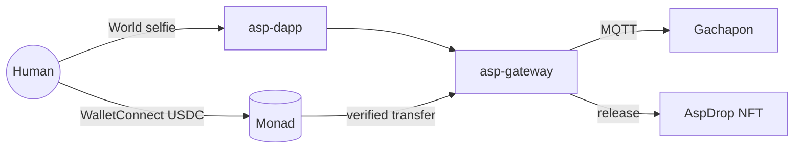

# Asp — AntiScalper Protocol

<div align="center">
  

**One human. One item.**  
Limited drops that only a real person can claim, paid in USDC on Monad.

[Live demo](https://altaga-asp.expo.app) · [NFT drop](https://altaga-asp.expo.app/test/claim) · [AspDrop on MonadVision](https://monadvision.com/address/0x942c1a378b961fb7a95b83ecaf55fecee42c6187) · [Technical walkthrough](./TECHNICAL.md)

</div>

---

## Metropolis submission

| | |
|---|---|
| Track | **03 · Social, Attention & Culture**: ticketing and access that follow a *person*, not an email or a wallet |
| Chain | Monad mainnet (`eip155:143`), USDC |
| Identity | World ID (Proof of Human) |
| On-chain | [`AspDrop`](https://monadvision.com/address/0x942c1a378b961fb7a95b83ecaf55fecee42c6187), 20 editions, art rendered by the contract |
| Hardware | XIAO ESP32-C5 gachapon, one motor turn per paid claim |
| Live | [altaga-asp.expo.app](https://altaga-asp.expo.app) |

Built inside the [Metropolis](https://monad.xyz/developers/hackathons/metropolis) window: the repo starts on 30 Sep 2026.

---

## The problem

A limited capsule drops. Fans line up, and so do bots, farmed wallets and resellers.

Every drop today is gated by something cheap to fake: an email, a wallet, a queue position. A payment tells you someone *paid*. It doesn't tell you:

| Question | Why a payment alone fails |
|---|---|
| **Who** paid? | A hot wallet is not a person. One scalper can hold a thousand. |
| Is it the **same** person who won? | Tickets get resold the moment they exist. |
| Did they **already** claim? | A second wallet, a second account or a retry looks like a new buyer. |

## The idea

Make the ticket follow the **human**, and make the money **verifiable on-chain**.

- **World** welds your ticket to a zk nullifier: a number that's unique to you for this drop, without revealing who you are. At claim time you prove again, and the nullifier has to match.
- **Monad** carries the payment. You pay USDC from your own phone wallet; the gateway reads the transfer on-chain before anything moves. Blocks land fast enough that the person at the machine doesn't wait, and gas is cheap enough to mint a collectible per claim.

```text
Win      World selfie → ticket WIN-… bound to your nullifier
Claim    Same human, same nullifier, or the claim dies
Pay      Phone wallet over WalletConnect → tagged USDC transfer on Monad
Release  One motor turn, or one AspDrop edition. Never twice.
```

---

## Demo walkthrough

<table>
  <tr>
    <td width="33%"></td>
    <td width="33%"></td>
    <td width="33%"></td>
  </tr>
  <tr>
    <td><b>1 · Get</b><br/>Prove you're human with a World selfie. The machine holds one item for you and prints a <code>WIN-…</code> ticket.</td>
    <td><b>2 · Claim</b><br/>Enter the ticket, prove again (same nullifier), scan the WalletConnect QR and pay 0.002 USDC from your phone.</td>
    <td><b>3 · Release</b><br/>The gateway confirms the transfer on Monad, then the gachapon turns once, or one <code>AspDrop</code> edition lands in your wallet.</td>
  </tr>
</table>

| Route | What you see |
|---|---|
| [`/`](https://altaga-asp.expo.app) | Get a ticket with World |
| [`/claim`](https://altaga-asp.expo.app/claim) | Claim it at the physical machine: pay, motor turns |
| [`/test/claim`](https://altaga-asp.expo.app/test/claim) | Same claim, but you receive an on-chain `AspDrop` edition instead |

Try to break it: use a second wallet, a different face, or the same ticket twice. Each one is refused.

---

## What makes it hold

**A claim only goes through when every check passes.** If any one fails, nothing is released.

| Check | Blocks |
|---|---|
| World proof verified server-side by World's portal | Bots, fake proofs |
| Nullifier at claim = nullifier at ticket | Resold or shared tickets |
| Ticket burned on release | Second claims, retries |
| USDC `Transfer` of the **exact** price to the gateway, in a tx tagged with this claim's nonce | Paying for someone else, underpaying, fake tx hashes |
| Tx hash used only once | Replaying one payment for two items |
| `AspDrop` mints at most one edition per paid claim | Double mints on retry |

Every deny path, with error codes: [TECHNICAL.md](./TECHNICAL.md).

---

## How it fits together



| Package | Job |
|---|---|
| [`asp-dapp`](asp-dapp) | Dispenser UI (Expo web), World verify, WalletConnect pay (Reown AppKit + wagmi), NFT release |
| [`asp-gateway`](asp-gateway) | PoH gate, ticket ↔ nullifier registry, on-chain USDC verify, MQTT dispatch |
| [`asp-nft`](asp-nft) | `AspDrop.sol`: ERC-721 limited run with on-chain SVG |
| [`asp-devices`](asp-devices) | XIAO ESP32-C5 firmware: waits for one dispense from the gateway |
| [`x402-examples`](x402-examples) | Monad x402 facilitator (see [below](#extra-hire-a-machine-over-x402)) |

---

## The capsules

Ten colorways, twenty editions. `tokenURI` returns base64 JSON with a base64 SVG inside, so there's no IPFS and no server to go down.

<div align="center">
  
  
  
  
  
  
  
  
  
  
</div>

| On Monad mainnet | Address |
|---|---|
| `AspDrop` (`ASPCAP`) | [`0x942c1a378b961fb7a95b83ecaf55fecee42c6187`](https://monadvision.com/address/0x942c1a378b961fb7a95b83ecaf55fecee42c6187) |
| USDC | [`0x754704Bc059F8C67012fEd69BC8A327a5aafb603`](https://monadvision.com/address/0x754704Bc059F8C67012fEd69BC8A327a5aafb603) |
| Price per claim | `0.002 USDC` |

---

## Run it

```bash
# UI → http://localhost:8087
cd asp-dapp && cp .env.example .env && npm install && npx expo start --web --port 8087

# Gateway (separate terminal)
cd asp-gateway && cp .env.example .env && npm install && npm start

# Your own AspDrop run (optional)
cd asp-nft && npm install && npm run wallet && npm run compile && npm run deploy && npm run mint
```

Booth steps: [SIMULATOR.md](./SIMULATOR.md) · Firmware: [asp-devices](asp-devices/README.md) · Deep dive: [TECHNICAL.md](./TECHNICAL.md)

---

## Extra: hire a machine over x402

Not part of the drop demo. The same gateway also lets agents and apps rent a machine per use: `POST /asp/hire` answers `402`, the caller signs a USDC authorization, and a Monad facilitator settles it. Skills that need a human (like this drop) still require World first, so an agent can knock but can't skip the line. Contract and samples: [AGENT.md](./AGENT.md), [`x402-examples`](x402-examples), and the `/chat` tab in the app.

<div align="center"><sub>World · Monad · AntiScalper Protocol · Monad Metropolis 2026</sub></div>
