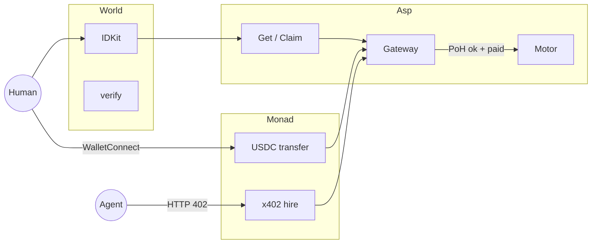
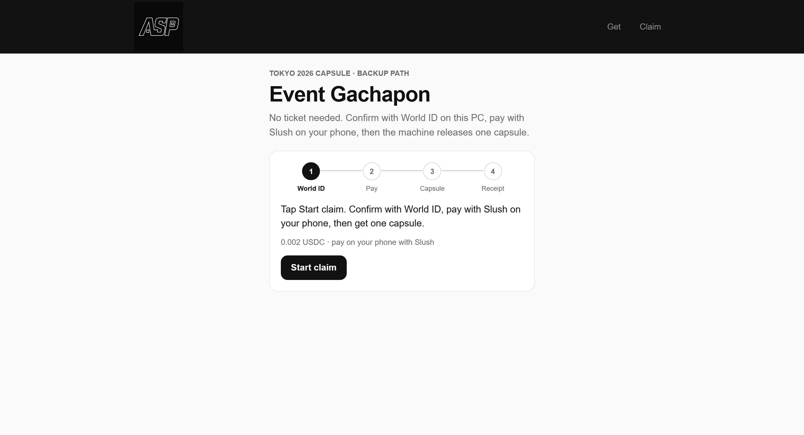
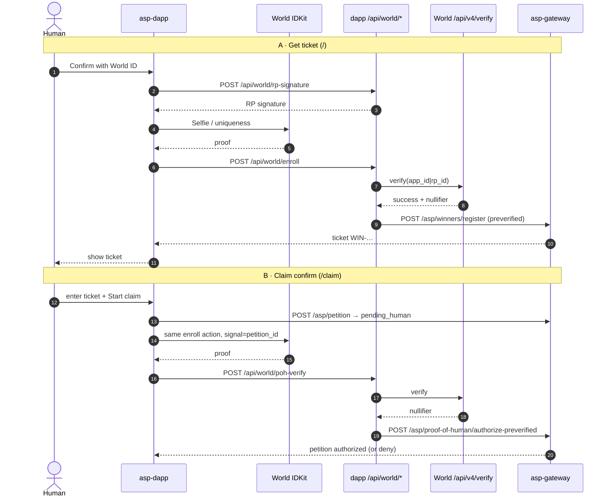
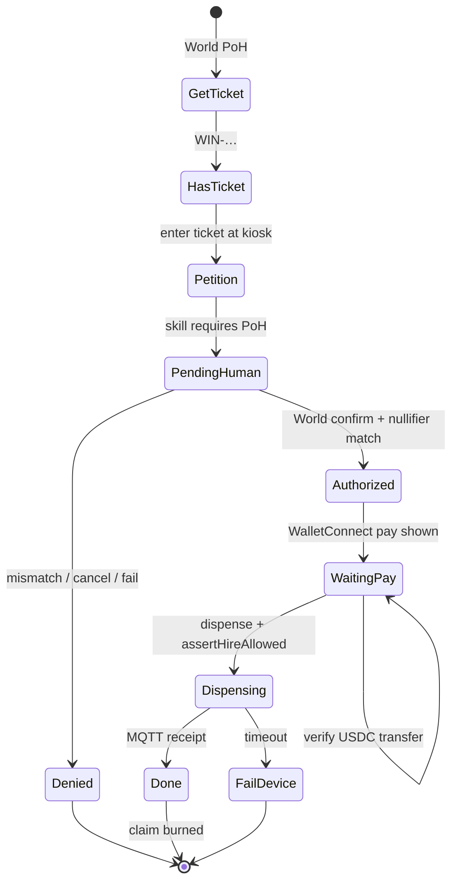

# Asp — AntiScalper Protocol

<div align="center">
  
</div>

**Machines you can hire on Monad. Drops scalpers can't steal.**

Partner rails: **World** + **Monad**

<div align="center">

**Fast links** · [Live demo](https://altaga-asp.expo.app) · [World](#world) · [Monad](#monad)

</div>

Asp puts real hardware on a paid HTTP rail. Agents hire machines with **x402** (USDC on Monad).  
When the release is scarce, the machine flips the other switch: **World Proof of Human** — then the human pays USDC on Monad from their phone wallet and the motor spins once.

---

## The problem

Limited capsule. Fans in line. Bots and wallets in the same line.

Money alone answers *paid?* — never *who?* or *already claimed?*

| Question | Why a naked pay fails |
|---|---|
| **Who?** | A hot wallet is not a person |
| **What?** | One unit from *this* machine, this release |
| **Once?** | Second face / second wallet / retry must die |

Asp’s answer is two rails sharing one stack:

1. **World** — the fairness switch (ticket ↔ zk nullifier ↔ same human at claim)
2. **Monad** — the money rail (**x402** to hire machines · **WalletConnect USDC transfer** when the human settles at the booth)

---

## The beat

```text
Win      World selfie → ticket WIN-… welded to your nullifier
Claim    Same human. Same nullifier. Or the petition dies.
Pay      Monad — phone wallet over WalletConnect, tagged USDC transfer
Spin     Gateway verifies the transfer on-chain → MQTT → one motor turn
```

**The twist:** machines on Asp are hireable over **x402** — agents included.  
*This* machine is PoH-gated. An agent can knock; it cannot skip World. So for the drop, the human walks up, proves, and **pays on Monad from their own wallet**. Scalpers don't get a faster lane. Agents don't get a backdoor.

---

## Architecture (big picture)



| Package | Job |
|---|---|
| [`asp-dapp`](asp-dapp) | Ticket + claim UI · World verify · WalletConnect pay (Reown AppKit + wagmi) |
| [`asp-gateway`](asp-gateway) | Petitions · PoH gate · kiosk USDC verify · x402 hire |
| [`asp-devices`](asp-devices) | ESP32 — one spin per authorized action |
| [`x402-examples`](x402-examples) | Monad x402 facilitator (pays gas to settle EIP-3009 USDC) + buyer/seller samples |

---

## Demo surfaces

| Route | Flow |
|---|---|
| `/` **Get ticket** | World PoH → `WIN-…` code |
| `/claim` **Claim** | Ticket → World confirm → phone wallet pay → motor |
| `/v1` **Backup** | World → phone wallet pay → motor (no pre-ticket) |
| `/kiosk` **Pay lab** | WalletConnect pay only — no World, never runs the motor |

<div align="center">
  
</div>
<div align="center"><i>World — Get ticket</i></div>

<br/>

<div align="center">
  
</div>
<div align="center"><i>World + Monad — Claim</i></div>

<br/>

<div align="center">
  
</div>
<div align="center"><i>Backup — same gates, no pre-ticket</i></div>

---

<a id="world"></a>

# Rail 1 — World (IDKit)

### Why World is essential

Without World, any hot wallet can claim. Fair scarce access dies.

World is the **zk credential that ties ticket → claim → same human**:

- enroll (ticket) binds a nullifier to `WIN-…`
- claim re-verifies against World’s portal; nullifier must match
- deny / cancel / fail ⇒ **no pay, no motor** (fail-closed)

### End-to-end World flow



### Deny paths (product proof)

| Error | Effect |
|---|---|
| `world-verify-failed` | Portal reject → no authorize |
| `nullifier-mismatch` | Different human than signup → no pay |
| `already-claimed` / `claim-already-used` | Entitlement burned → motor idle |
| `signal-mismatch` | Proof not bound to this petition |
| cancelled / expired IDKit | Protected action never starts |

### World file map

| File | Role |
|---|---|
| [`asp-dapp/src/features/world/WorldVerifyModal.tsx`](asp-dapp/src/features/world/WorldVerifyModal.tsx) | IDKit Selfie UI + RP signature |
| [`asp-dapp/src/app/api/world/rp-signature+api.ts`](asp-dapp/src/app/api/world/rp-signature+api.ts) | Server-only RP sign |
| [`asp-dapp/src/app/api/world/enroll+api.ts`](asp-dapp/src/app/api/world/enroll+api.ts) | Signup verify → register winner |
| [`asp-dapp/src/app/api/world/poh-verify+api.ts`](asp-dapp/src/app/api/world/poh-verify+api.ts) | Claim verify → authorize-preverified |
| [`asp-gateway/src/services/policy/pohVerify.js`](asp-gateway/src/services/policy/pohVerify.js) | Fail-closed portal verify |
| [`asp-gateway/src/services/policy/winners.js`](asp-gateway/src/services/policy/winners.js) | Ticket ↔ nullifier registry |
| [`asp-gateway/src/services/policy/store.js`](asp-gateway/src/services/policy/store.js) | Petition `pending_human` → `authorized` |
| [`asp-gateway/src/services/policy/routes.js`](asp-gateway/src/services/policy/routes.js) | `/asp/winners/*`, `/asp/proof-of-human/*` |

---

<a id="monad"></a>

# Rail 2 — Monad (payments)

### Why Monad

Asp is a machine economy. Settlement has to live on a chain the booth can wait on — not a `paid=true` checkbox. Monad blocks land fast enough that a person standing at the machine doesn’t notice the wait.

Two doors into the same gateway, both USDC on Monad (chain `143`):

| Door | Who | How |
|---|---|---|
| **x402 hire** | Agents / apps | `POST /asp/hire` → 402 challenge → signed EIP-3009 authorization → facilitator settles → skill runs |
| **WalletConnect pay** | Human at the booth | Reown AppKit QR → phone wallet sends a tagged USDC transfer → gateway verifies the receipt → motor |

Same policy gate on both: if the skill is PoH-locked, World must authorize first.  
*This* capsule is locked, so the live demo is **human + phone wallet on Monad**. x402 stays lit as the way machines get hired when the skill allows it — it does **not** settle the kiosk pay.

### Kiosk pay → motor


### What “paid” means

`verifyUsdcPayment` in [`monadPayment.js`](asp-gateway/src/services/kiosk/monadPayment.js) only says yes when **all** of these hold:

- the tx receipt succeeded and the tx called the configured USDC contract
- the calldata ends with this intent’s nonce tag (`keccak256("asp-kiosk:" + nonce)`, 16 bytes)
- a `Transfer` log moves **exactly** the quoted amount to the gateway receiver
- the block is newer than the intent
- the tx hash was never used by another intent (replay guard)

Anything else stays unpaid — the motor never hears about it.

### Monad deny paths

| Signal | Meaning |
|---|---|
| `payment-not-found` | Tx not mined yet — keep polling |
| `payment-tx-replayed` (409) | Same tx hash already paid another intent |
| `pending-human` | Tried to pay before World authorize |
| `assertHireAllowed` fail | Scope / expiry / claim already used |
| `esp32-no-receipt` (504) | Motor path timed out |
| `lab-intent-no-dispense` | Lab pay never runs the motor |

### Monad file map

| File | Role |
|---|---|
| [`asp-gateway/src/services/kiosk/monadPayment.js`](asp-gateway/src/services/kiosk/monadPayment.js) | Build tagged USDC transfer · fail-closed verify |
| [`asp-gateway/src/services/kiosk/routes.js`](asp-gateway/src/services/kiosk/routes.js) | `/asp/kiosk/intent`, `/intent/:nonce/tx`, `/dispense` |
| [`asp-gateway/src/services/monad/chain.js`](asp-gateway/src/services/monad/chain.js) | Chain, RPC fallbacks, USDC address |
| [`asp-gateway/src/services/x402/routes.js`](asp-gateway/src/services/x402/routes.js) | `/asp/hire` on `@x402/evm` exact scheme |
| [`asp-dapp/src/features/wallet/`](asp-dapp/src/features/wallet) | Reown AppKit, wagmi, `useWalletPay`, `useX402Fetch` |
| [`asp-dapp/src/features/control/WalletPayPanel.tsx`](asp-dapp/src/features/control/WalletPayPanel.tsx) | Phone pay UI |
| [`asp-dapp/src/features/control/useCheckoutFlow.ts`](asp-dapp/src/features/control/useCheckoutFlow.ts) | Claim state machine |
| [`x402-examples/Facilitator/index.mjs`](x402-examples/Facilitator/index.mjs) | Monad x402 facilitator |

---

## Combined product loop



**Second claim with the same entitlement must fail.** That beat is the product.

---

## Quick start

```bash
# UI
cd asp-dapp && cp .env.example .env    # Reown project id, gateway URL, World ids
npm install && npx expo start --web --port 8087
# → http://localhost:8087   /claim   /v1   /kiosk

# Gateway (separate terminal)
cd asp-gateway && cp .env.example .env   # receiver address, MQTT, facilitator URL — never commit
npm install && npm start

# x402 facilitator (only needed for /asp/hire)
cd x402-examples && npm install && npm run facilitator
```

Env templates: [`asp-dapp/.env.example`](asp-dapp/.env.example), [`asp-gateway/.env.example`](asp-gateway/.env.example), [`x402-examples/Facilitator/.env.example`](x402-examples/Facilitator/.env.example).  
Booth steps: [`SIMULATOR.md`](./SIMULATOR.md). Machine hire / x402 surface: [`AGENT.md`](./AGENT.md).

---

<div align="center">
  <sub>World · Monad · AntiScalper Protocol</sub>
</div>
