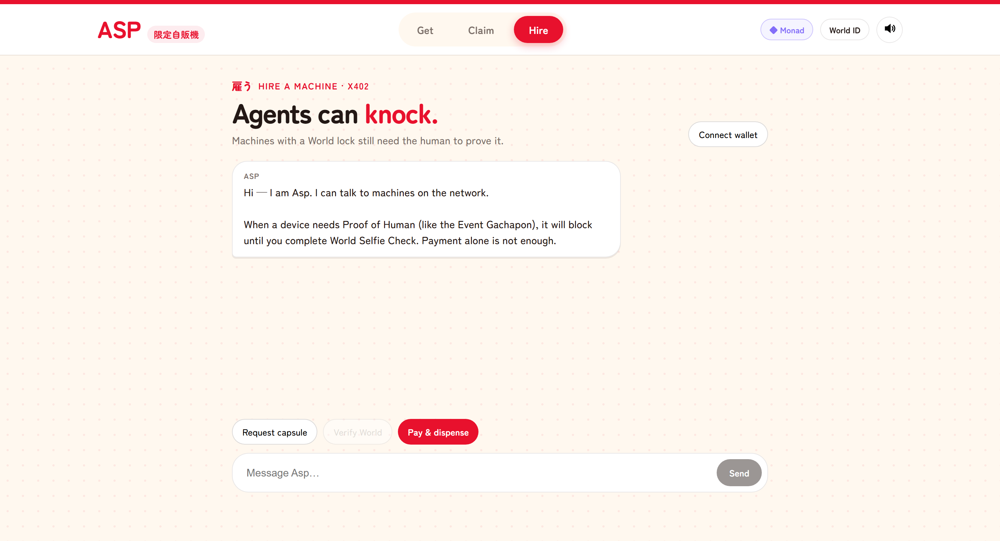
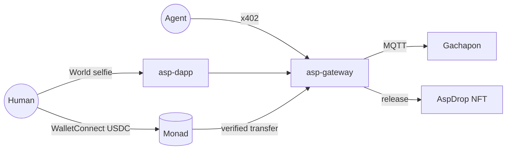

# Asp — AntiScalper Protocol

<div align="center">
  

**One human. One item.**  
Machines you can hire on Monad. Drops scalpers can't steal.

[Live demo](https://altaga-asp.expo.app) · [NFT drop](https://altaga-asp.expo.app/test/claim) · [AspDrop on MonadVision](https://monadvision.com/address/0x942c1a378b961fb7a95b83ecaf55fecee42c6187) · [Technical walkthrough](./TECHNICAL.md)

</div>

---

## Metropolis submission

| | |
|---|---|
| Track | **03 · Social, Attention & Culture**: access that follows a *person*, not an email or a wallet |
| Chain | Monad mainnet (`eip155:143`), USDC |
| Identity | World ID (Proof of Human) |
| On-chain | [`AspDrop`](https://monadvision.com/address/0x942c1a378b961fb7a95b83ecaf55fecee42c6187), 20 editions, art rendered by the contract |
| Hardware | XIAO ESP32-C5 gachapon, one motor turn per paid claim |

Built inside the [Metropolis](https://monad.xyz/developers/hackathons/metropolis) window: the repo starts on 30 Sep 2026.

---

## Why

A limited drop sells out to bots. A payment tells you someone *paid*, not *who* paid or whether they *already claimed*.

Asp answers all three with two rails:

- **World**: your ticket is welded to a zk nullifier. Claiming needs the same human.
- **Monad**: you pay USDC from your phone wallet; the gateway checks the transfer on-chain before the machine moves.

```text
Win      World selfie → ticket WIN-…
Claim    Same human, same nullifier, or the claim dies
Pay      Phone wallet over WalletConnect → tagged USDC transfer on Monad
Release  One motor turn, or one AspDrop edition. Never twice.
```

Every machine on Asp can also be **hired over x402**, agents included. But this drop is PoH-locked: an agent can knock, it can't skip World.

---

## Screens

<table>
  <tr>
    <td width="50%"><br/><b>Get</b> · prove you're human, get a ticket</td>
    <td width="50%"><br/><b>Claim</b> · same human pays USDC, one item out</td>
  </tr>
  <tr>
    <td><br/><b>NFT drop</b> · the shelf is the on-chain run</td>
    <td><br/><b>Hire</b> · the x402 door for agents</td>
  </tr>
</table>

---

## How it fits together



| Package | Job |
|---|---|
| [`asp-dapp`](asp-dapp) | Dispenser UI, World verify, WalletConnect pay, NFT release |
| [`asp-gateway`](asp-gateway) | PoH gate, on-chain USDC verify, x402 hire, MQTT dispatch |
| [`asp-nft`](asp-nft) | `AspDrop.sol`, ERC-721 limited run with on-chain SVG |
| [`asp-devices`](asp-devices) | XIAO ESP32-C5 firmware |
| [`x402-examples`](x402-examples) | Monad x402 facilitator plus buyer/seller samples |

Full call sequences, deny paths and file maps: **[TECHNICAL.md](./TECHNICAL.md)**.

---

## The capsules

Ten colorways, twenty editions. `tokenURI` returns base64 JSON with a base64 SVG inside, so there's no IPFS and no server to go down.

<div align="center">
  
  
  
  
  
  
  
  
  
  
</div>

| On Monad mainnet | Address |
|---|---|
| `AspDrop` (`ASPCAP`) | [`0x942c1a378b961fb7a95b83ecaf55fecee42c6187`](https://monadvision.com/address/0x942c1a378b961fb7a95b83ecaf55fecee42c6187) |
| USDC | [`0x754704Bc059F8C67012fEd69BC8A327a5aafb603`](https://monadvision.com/address/0x754704Bc059F8C67012fEd69BC8A327a5aafb603) |
| Price per claim | `0.002 USDC` |

---

## Run it

```bash
cd asp-dapp && cp .env.example .env && npm install && npx expo start --web --port 8087
cd asp-gateway && cp .env.example .env && npm install && npm start
cd x402-examples && npm install && npm run facilitator   # only for /asp/hire
```

More: [TECHNICAL.md](./TECHNICAL.md) · [AGENT.md](./AGENT.md) (x402 hire) · [SIMULATOR.md](./SIMULATOR.md) (booth steps) · [firmware](asp-devices/README.md)

<div align="center"><sub>World · Monad · AntiScalper Protocol · Monad Metropolis 2026</sub></div>
