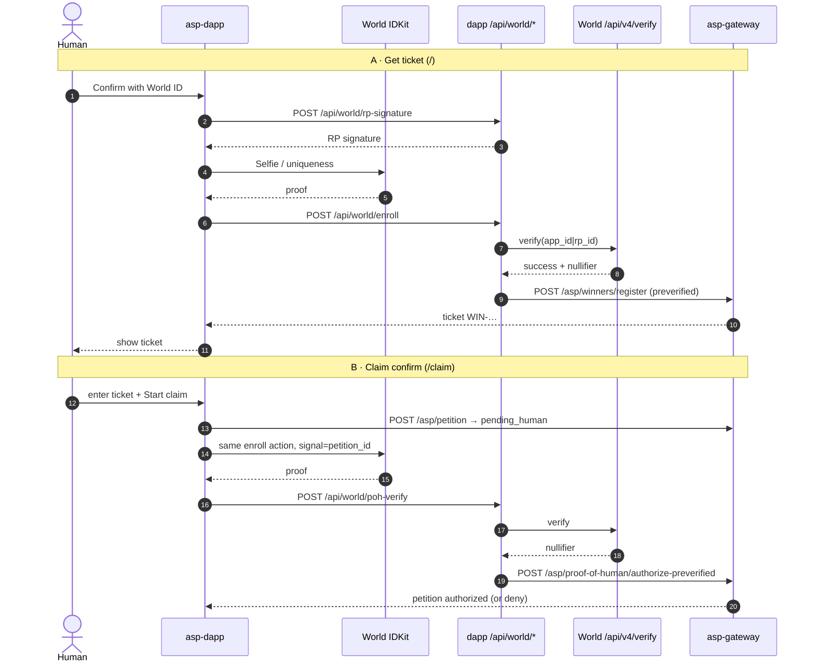
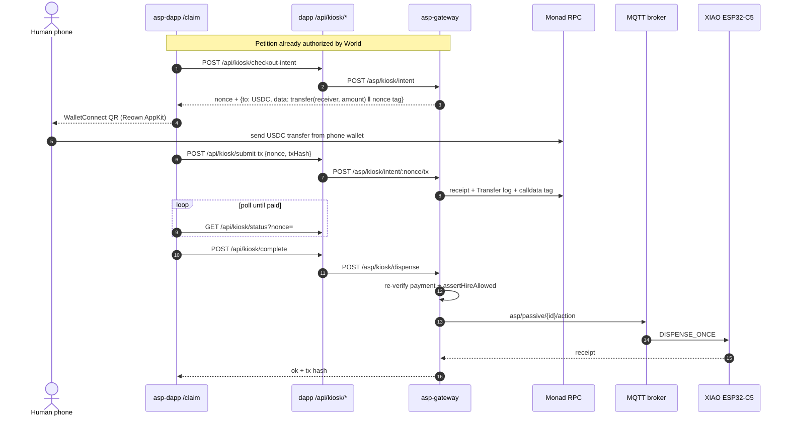
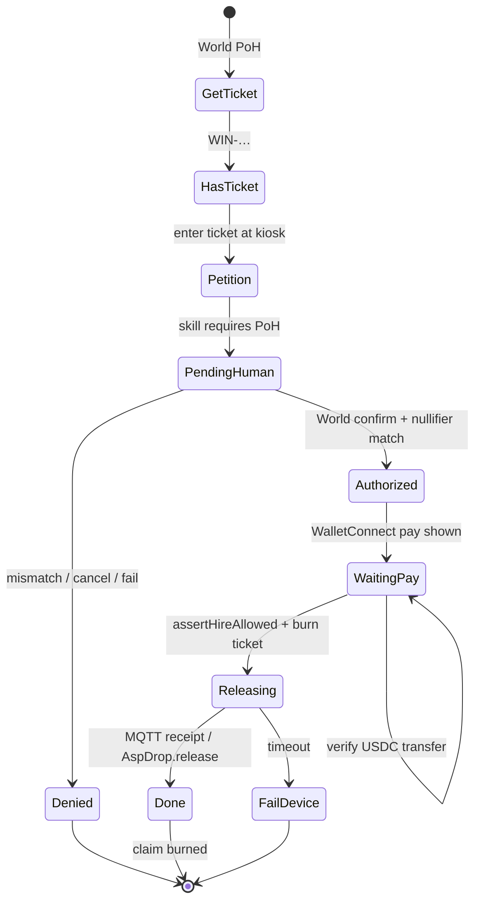

# Asp — technical walkthrough

The deep dive behind the [README](./README.md): every call, every deny path, every file.  
Machine hire / x402 contract: [`AGENT.md`](./AGENT.md). Booth steps: [`SIMULATOR.md`](./SIMULATOR.md).

- [Rail 1: World](#rail-1-world-idkit)
- [Rail 2: Monad](#rail-2-monad-payments--drop)
- [Combined product loop](#combined-product-loop)

---

## Rail 1: World (IDKit)

Without World, any hot wallet can claim and fair access to a scarce drop is gone.
World is the **zk credential that ties ticket → claim → same human**:

- enroll (ticket) binds a nullifier to `WIN-…`
- claim re-verifies against World's portal; the nullifier must match
- deny / cancel / fail ⇒ **no pay, no release** (fail-closed)

### End-to-end World flow

### Deny paths

| Error | Effect |
|---|---|
| `world-verify-failed` | Portal reject → no authorize |
| `nullifier-mismatch` | Different human than signup → no pay |
| `already-claimed` / `claim-already-used` | Entitlement burned → motor idle, no NFT |
| `signal-mismatch` | Proof not bound to this petition |
| cancelled / expired IDKit | Protected action never starts |

### World file map

| File | Role |
|---|---|
| [`asp-dapp/src/features/world/WorldVerifyModal.tsx`](asp-dapp/src/features/world/WorldVerifyModal.tsx) | IDKit Selfie UI + RP signature |
| [`asp-dapp/src/app/api/world/rp-signature+api.ts`](asp-dapp/src/app/api/world/rp-signature+api.ts) | Server-only RP sign |
| [`asp-dapp/src/app/api/world/enroll+api.ts`](asp-dapp/src/app/api/world/enroll+api.ts) | Signup verify → register winner |
| [`asp-dapp/src/app/api/world/poh-verify+api.ts`](asp-dapp/src/app/api/world/poh-verify+api.ts) | Claim verify → authorize-preverified |
| [`asp-gateway/src/services/policy/pohVerify.js`](asp-gateway/src/services/policy/pohVerify.js) | Fail-closed portal verify |
| [`asp-gateway/src/services/policy/winners.js`](asp-gateway/src/services/policy/winners.js) | Ticket ↔ nullifier registry |
| [`asp-gateway/src/services/policy/store.js`](asp-gateway/src/services/policy/store.js) | Petition `pending_human` → `authorized` |
| [`asp-gateway/src/services/policy/routes.js`](asp-gateway/src/services/policy/routes.js) | `/asp/winners/*`, `/asp/proof-of-human/*` |

---

## Rail 2: Monad (payments + drop)

Two doors into the same gateway, both USDC on Monad (chain `143`):

| Door | Who | How |
|---|---|---|
| **x402 hire** | Agents / apps | `POST /asp/hire` → 402 challenge → signed EIP-3009 authorization → facilitator settles → skill runs |
| **WalletConnect pay** | Human at the booth | Reown AppKit QR → phone wallet sends a tagged USDC transfer → gateway verifies the receipt → motor or NFT |

The same policy gate applies to both: if the skill is PoH-locked, World has to authorize first.
x402 is how machines get hired when the skill allows it. It does **not** settle the kiosk payment.

### Kiosk pay → release

On `/test/claim` the last leg swaps the motor for the chain: the dapp calls `POST /api/nft/drop` → gateway `POST /asp/kiosk/settle` (same checks, same ticket burn) → `AspDrop.release(payer, keccak256("asp-drop:" + nonce))`. The contract enforces one release per claim id: a second `release` with the same id reverts with `AlreadyReleased`. The server wrapper reads `tokenOfClaim` first, so a retry gets the existing token back instead of an error. Human eligibility is decided before this, in the gateway; the contract only sees claim ids.

### What "paid" means

`verifyUsdcPayment` in [`monadPayment.js`](asp-gateway/src/services/kiosk/monadPayment.js) only says yes when **all** of these hold:

- the tx receipt succeeded and the tx called the configured USDC contract
- the calldata ends with this intent's nonce tag (`keccak256("asp-kiosk:" + nonce)`, 16 bytes)
- a `Transfer` log moves **exactly** the quoted amount to the gateway receiver
- the block is newer than the intent
- the tx hash was never used by another intent (replay guard)

Anything else stays unpaid, and the motor never hears about it.

### Monad deny paths

| Signal | Meaning |
|---|---|
| `payment-not-found` | Tx not mined yet, keep polling |
| `payment-tx-replayed` (409) | Same tx hash already paid another intent |
| `pending-human` | Tried to pay before World authorize |
| `assertHireAllowed` fail | Scope / expiry / claim already used |
| `wrong-release-path` (409) | A motor payment can't release an NFT, and an NFT payment can't spin the motor |
| `sold-out` (410) | Every `AspDrop` edition is gone |
| `esp32-no-receipt` (504) | Motor path timed out |
| `lab-intent-no-dispense` | Gateway smoke-test payments never run the motor |

### Monad file map

| File | Role |
|---|---|
| [`asp-gateway/src/services/kiosk/monadPayment.js`](asp-gateway/src/services/kiosk/monadPayment.js) | Build tagged USDC transfer, fail-closed verify |
| [`asp-gateway/src/services/kiosk/routes.js`](asp-gateway/src/services/kiosk/routes.js) | `/asp/kiosk/intent`, `/intent/:nonce/tx`, `/dispense`, `/settle` |
| [`asp-gateway/src/services/monad/chain.js`](asp-gateway/src/services/monad/chain.js) | Chain, RPC fallbacks, USDC address |
| [`asp-gateway/src/services/x402/routes.js`](asp-gateway/src/services/x402/routes.js) | `/asp/hire` on the `@x402/evm` exact scheme |
| [`asp-nft/contracts/AspDrop.sol`](asp-nft/contracts/AspDrop.sol) | Limited run, `release` once per claim id, on-chain SVG |
| [`asp-dapp/src/features/nft/nftServer.ts`](asp-dapp/src/features/nft/nftServer.ts) | Server-only release: gateway settle → `AspDrop.release` |
| [`asp-dapp/src/features/wallet/`](asp-dapp/src/features/wallet) | Reown AppKit, wagmi, `useWalletPay`, `useX402Fetch` |
| [`asp-dapp/src/features/control/useCheckoutFlow.ts`](asp-dapp/src/features/control/useCheckoutFlow.ts) | Claim state machine |
| [`x402-examples/Facilitator/index.mjs`](x402-examples/Facilitator/index.mjs) | Monad x402 facilitator |

---

## Combined product loop

**A second claim with the same entitlement has to fail.** That's the product.
